<div align="center">

# Mission Control

**A phone remote for coding agents on your own models —
self-hosted, with approval gates.**

Ask your lead agent from the couch, watch every edit land as a live diff,
answer its questions with a tap — and keep the risky steps behind your
approval. Runs on your hardware, prefers your local models, AGPL —
with **one-click model recipes for one or two NVIDIA DGX Spark boxes**.

[](https://github.com/argyelan-ai/mission-control/actions/workflows/ci.yml)
[](https://github.com/argyelan-ai/mission-control/releases)
[](LICENSE)

[Spark recipes](#one-click-model-recipes-for-dgx-spark--one-box-or-two) · [Install](#install) · [What it does](#what-it-does) · [Maturity](#what-is-stable-and-what-is-not) ·
[Docs](#docs) · [Roadmap](#where-its-going) · [Community](#community)

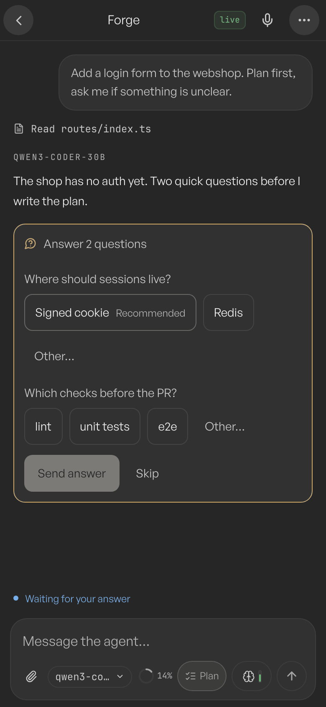

</div>

## One-click model recipes for DGX Spark — one box or two

Pick a recipe on the **Runtimes** page and click **Install** — the recipe
downloads the weights and sets up its engine while MC shows the live install
log. For two-box recipes MC picks a free second box and wires it in. One
click on **Start** switches a box (or a pair) to another recipe; a switch
lock refuses it while the engine is still serving requests.

| Recipe | Boxes | Engine | Measured on 2× DGX Spark |
|---|---|---|---|
| **GLM-5.3-Flash** · EXL3 4-bit · TensorFold | **2** (tensor parallel) | TensorFold | **62.6 tok/s** single stream · **211 tok/s** at 16 parallel · 1M context per request · prefill ~1,800 tok/s |
| **DeepSeek-V4-Flash** · SparkInfer | 1 | vLLM | — |
| **DeepSeek-V4-Flash** · ds4 | 1 | ds4 | — |

Three recipes install with one click today; two more start with one click
once the weights are on the box, and the [catalog](backend/config/local-recipes.json)
lists further models. Numbers: our own benchmark (tokens counted from the
API's `usage`, greedy, 512-token answers, 08 Oct 2026); the same weights on
the plain vLLM recipe reach 34.6 tok/s — the dedicated recipe is ~1.8×
faster. How it works: [ADR-077](docs/decisions/077-rezept-modell-ein-startbefehl.md)
· [Runtimes](docs/handbook/concepts/runtimes.md).

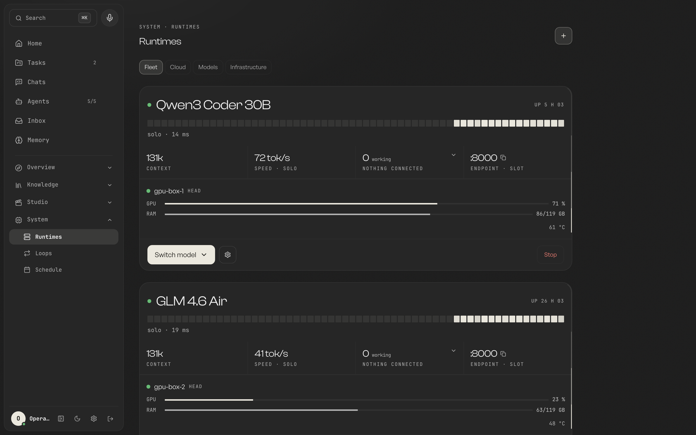

## Why

Coding agents are good enough to work while you are away from the desk.
The tools around them are not:

- **You can't see what they do.** A terminal on another machine is no use on
  a phone. MC turns the agent's work into a chat you can read anywhere:
  every tool call, every edit as a diff, every file it touched.
- **You can't step in.** When an agent asks a question or wants approval, it
  waits — until you are back at a keyboard. In MC the question arrives as a
  card on your phone; you tap the answer and it carries on.
- **Your code and prompts go to someone else's cloud.** MC is self-hosted.
  Point the local agent at your own GPU box (vLLM, LM Studio, Ollama, any
  OpenAI-compatible `/v1`) and that work never leaves your network.
- **"Autonomous" usually means "unsupervised".** In MC, agents ask before
  risky actions — deploys, config changes, external posts — and your
  autonomy level decides whether that becomes a card you have to approve.
  MC also tells you exactly where the tokens went.

## What it does

MC is built around **two fixed agents** and one chat to steer them:

- a **lead agent** — your right hand, on Claude Code or on a local model;
- a **local omp agent** — small jobs on your own GPU box, driven over ACP.

### Watch every edit as it happens

Live tool output, a diff for each edit, file chips and the session cost —
in the chat, on phone and desktop. The **Changes panel** lists what this chat
changed, file by file, with **Revert**, **Commit** and **Open PR**.

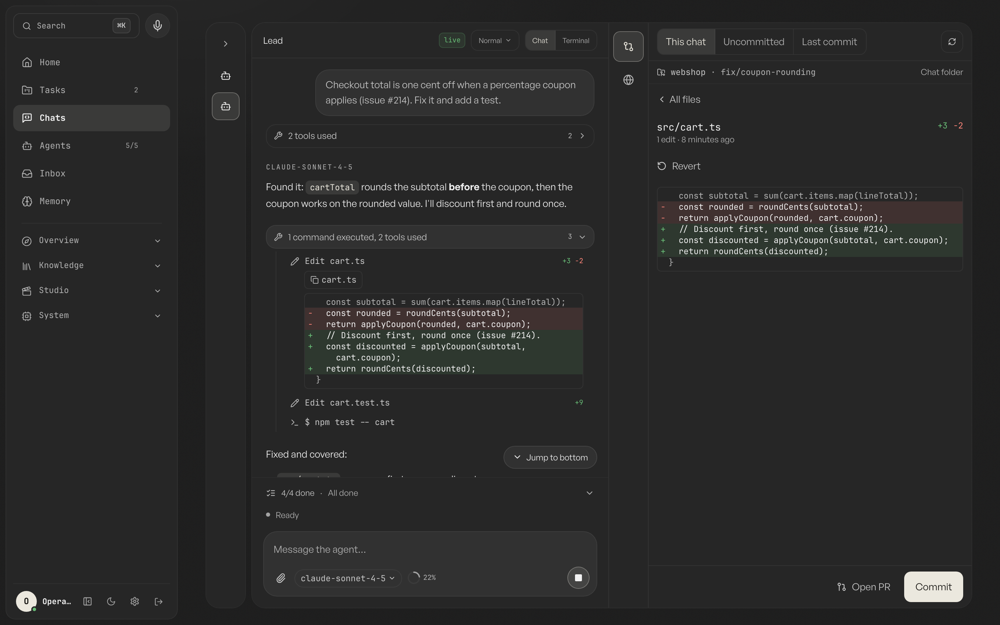

The commit message is suggested by your local model when one is set up
(otherwise MC writes a plain summary). The commit stays on your machine until
you open the PR.

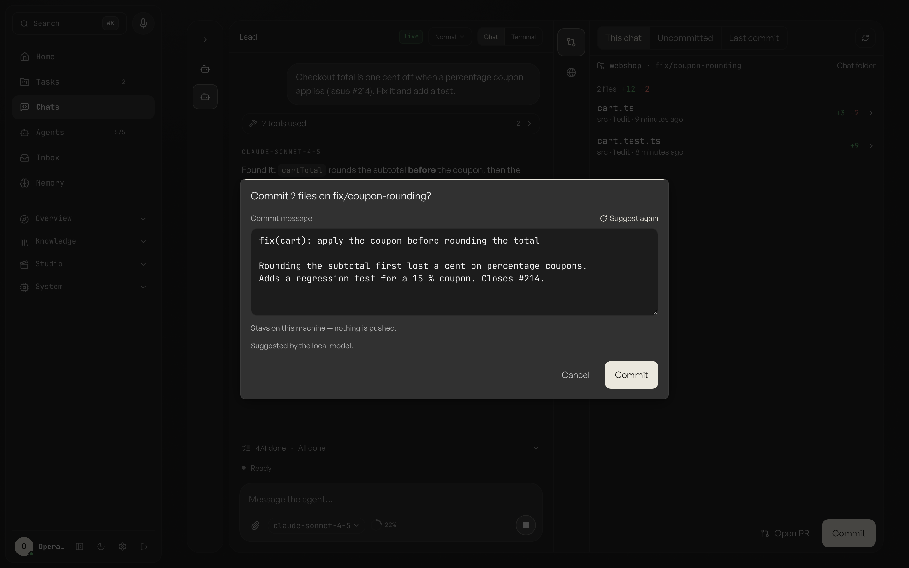

### Answer questions and approve plans from your phone

The local omp agent can stop and ask. Its questions arrive as **question
cards**; in **plan mode** it writes a plan first and waits for *Approve*,
*Refine* or *Cancel*. Screenshots taken by browser tools show up right on
the tool card.

<p align="center">
  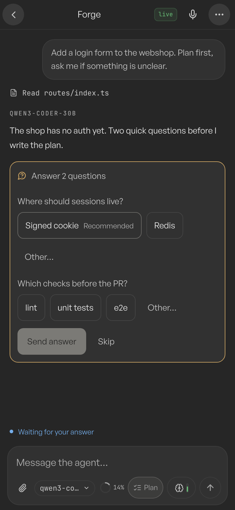
  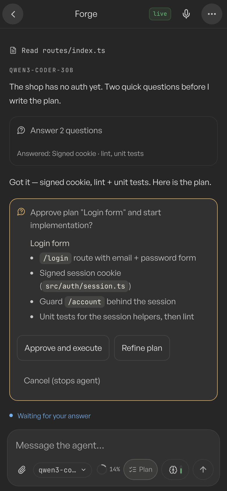
</p>

Phone use is **monitor and steer**: read, answer, approve, stop, send the
next instruction. Full editing stays at the desk. MC installs as a home
screen app (PWA manifest); it is not an offline app.

### Optional: talk to it

Call your lead agent from the chat and give instructions by voice. This uses
**OpenAI Realtime with your own API key** and has a **daily budget cap**
(default 5 USD). It is off by default (`VOICE_LIVE_ENABLED`) and in preview
([ADR-091](docs/decisions/091-live-voice-in-the-chat.md), still *Proposed*). On a phone the
browser only allows the microphone over HTTPS — see
[Reverse proxy & remote access](docs/handbook/operations/reverse-proxy.md#https-with-your-own-certificate).

## Local first, honestly

Your GPU boxes show up as runtimes with model, context, speed and load.
For each agent you choose the runtime yourself; heads (preview) pre-select a
local runtime when one exists. There is no automatic fallback from local to
cloud yet.


Not every coding tool runs on every model. The matrix shows what works
today — and says **no**, with the reason, where it doesn't:

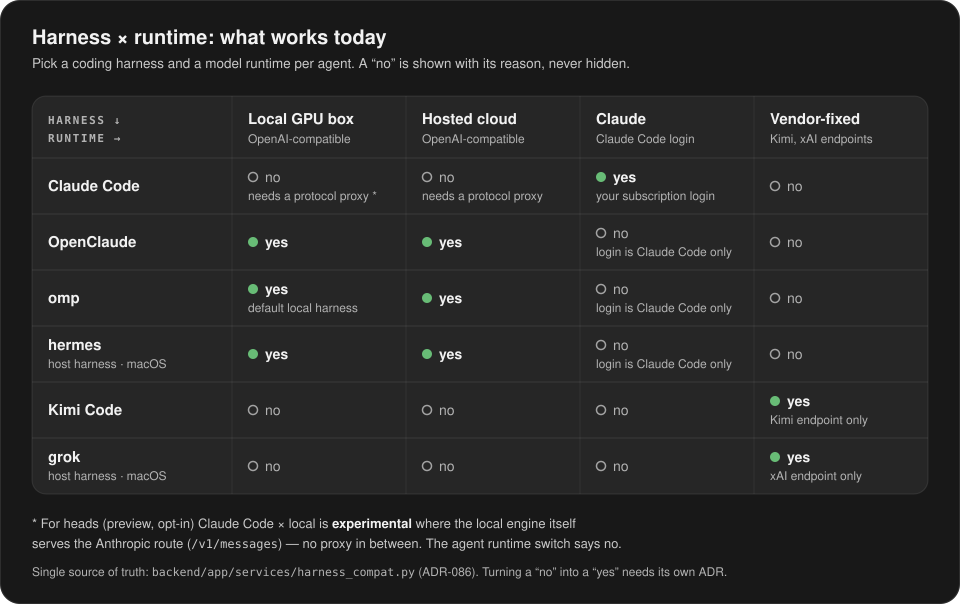

- **Claude Code runs on Claude.** It uses your own Claude Code login. Check
  your plan's terms for automated use.
- **Local models run through omp or OpenClaude.** Claude Code on a local
  model is not offered for agents.
- Switching an agent between runtimes goes through one switch service with a
  health check and rollback.

Details: [Runtimes](docs/handbook/concepts/runtimes.md) ·
[Run agents on a local LLM](docs/handbook/howto/local-llm.md).

## Guardrails

Agents ask MC before risky actions, and your settings decide what happens:

- **Autonomy levels per action.** For each kind of action you choose
  *Auto* (done), *Notify* (done, and you are told) or *Approve* (a card that
  waits for you). Deploys, config changes and external posts are set to
  *Approve* by default.
- **Approval cards.** An action set to *Approve* becomes a card in your inbox
  — one tap to allow or refuse, from the phone too.
- **Honest limit:** this gate works because the agent asks. MC does not yet
  block an agent that skips the question, and the local omp agent runs its
  own tools without per-call prompts. The enforced gates today are the ADR
  gate below and your Git host's branch protection.
- **ADR gate.** A pull request that changes a decision record cannot merge
  until you have approved that exact text. Editing it afterwards voids the
  approval.
- **Git, not magic.** Work lands on branches and pull requests. Merges use
  the GitHub CLI (`gh pr merge --squash`) and respect your branch protection
  and merge queue. There is no merge button in the phone chat.

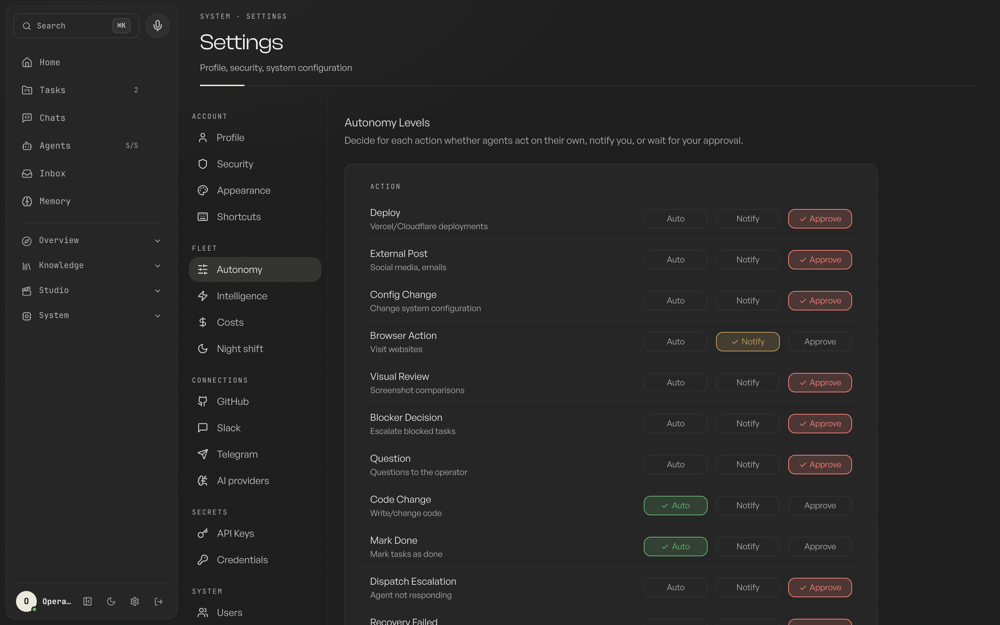

## See where the tokens go

**Insights** shows tokens per day, the share that ran locally, where usage
comes from (lead agent, omp agents, heads, you) and the local share per
week. Costs are shown at list price, even on flat-rate plans, so you can
compare. The chat's context ring shows the prompt cache hit rate.

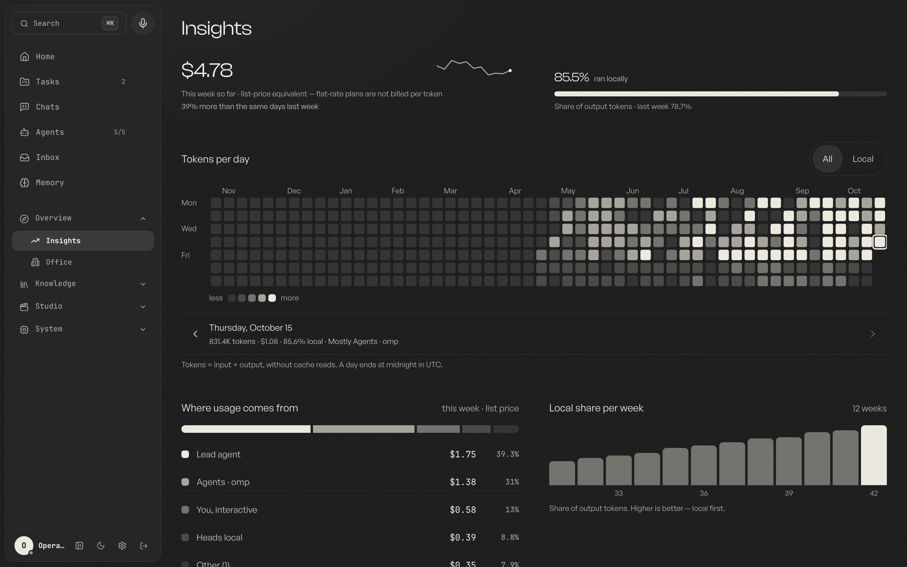

*The numbers in this picture are demo data.*

## What is stable and what is not

MC is changing direction ([ADR-085](docs/decisions/085-head-per-job.md),
[ADR-089](docs/decisions/089-lead-agent-with-hands.md),
[ADR-090](docs/decisions/090-chat-as-remote-control.md)): away from a
permanent fleet of named agents, towards one lead agent, one local agent and
the chat as remote control. Here is where each part stands.

| Status | What | How to get it |
|---|---|---|
| **Stable** | Core stack (boards, tasks, inbox, memory/vault, runtimes, insights, settings) · autonomy levels, approval cards, ADR gate · runtime switch with rollback | Default install |
| **New (Oct 2026), live** | Chat with live diffs and Changes panel (Revert / Commit / Open PR) · question cards and plan mode for omp agents · tool screenshots. In daily use; the phone acceptance check and reliability work are still open ([ROADMAP](docs/ROADMAP.md)) | Default install |
| **Preview, opt-in** | **Heads** — one short-lived coding session per job, in its own git worktree, ending in a PR and a run record | `HEADS_ENABLED=true` · **macOS host** (launchd + sandbox profile) |
| **Preview, opt-in** | **Night shift** — "run tonight" jobs and a morning report | `NIGHT_SHIFT_ENABLED=true` · needs heads, so **macOS host** |
| **Preview, opt-in** | **Live voice** in the chat ([ADR-091](docs/decisions/091-live-voice-in-the-chat.md)) | `VOICE_LIVE_ENABLED=true` + `OPENAI_API_KEY` · daily budget cap · HTTPS on the phone |
| **Frozen** | The persistent agent fleet (dispatch, healers, group chat) · Skill Lab, ClawHub and plugin management | Still in the code, no new work; being removed step by step ([ROADMAP](docs/ROADMAP.md) E5) |

**Fresh installs still start with the classic board.** The first-run wizard
offers a demo board with a small demo crew of agents and sample tasks. That
is the older picture of MC. The two-agent setup above is not created by the
wizard yet — the [quickstart](docs/handbook/howto/quickstart.md) walks you
through it.

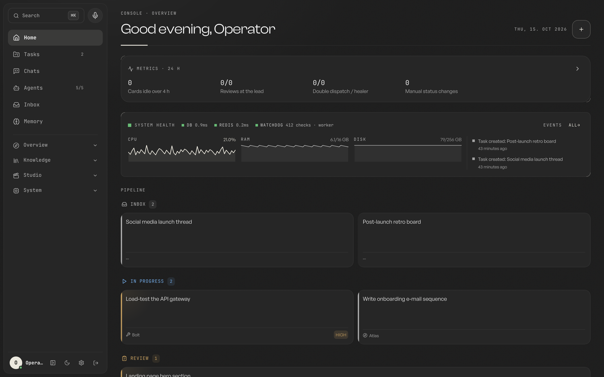

## Install

```bash
curl -fsSL https://raw.githubusercontent.com/argyelan-ai/mission-control/main/install.sh | bash
```


The installer checks prerequisites, clones the repo, writes `.env` with
fresh secrets, pulls the prebuilt images (or builds locally), starts the
stack and opens the browser. A first-run wizard then asks for the admin
account and LLM access (an API key or your Claude Code login) and offers the
demo board. Update later with `./install.sh --update`.

**After the install, no agent is running yet.** The one-liner gives you the
core stack. To get a lead agent and a local omp agent you can steer from the
chat, follow
**[Quickstart: install to your first remote-controlled agent](docs/handbook/howto/quickstart.md)**.

Manual install:

```bash
git clone https://github.com/argyelan-ai/mission-control.git
cd mission-control
./setup.sh                    # writes .env with secure secrets
docker compose up --build -d  # build + start, migrations run automatically
```

Then open **http://localhost** and register the first admin user.

### Reach it from your phone

MC binds to `127.0.0.1` by default. To use it from your phone, put the
machine on a [Tailscale](https://tailscale.com) tailnet (or your own VPN),
set `MC_BIND_ADDRESS=0.0.0.0` and `PUBLIC_HOST` in `.env` after the first
admin exists, and restart Caddy and the backend. Keep MC off the public
internet. Voice on the phone needs HTTPS (for example with `tailscale cert`). Guide: [Reverse proxy & remote access](docs/handbook/operations/reverse-proxy.md).

## Platforms

| Platform | Path | Notes |
|---|---|---|
| **macOS** | the one-liner | Everything, including heads and night shift (preview) |
| **Linux server / NAS** | the one-liner | Core stack and Docker agents; no heads or host agents (they need macOS launchd) |
| **Windows 10/11** | `.\setup.ps1` — sets up WSL2 + Docker, then runs the installer ([guide](docs/setup/windows.md)) | Same as Linux |
| **Windows Server / company VM** | a small Linux VM next to your Windows VMs ([guide](docs/setup/windows.md#windows-server--company-hypervisors)) | Same as Linux |
| **Runtipi** | [community app store](https://github.com/argyelan-ai/tipi-store) | Core stack only |
| **Portainer** | [`deploy/catalogs/portainer-template.json`](deploy/catalogs/portainer-template.json) as an App Template source | Core stack only |
| **Umbrel / CasaOS** | manifests prepared in [`deploy/catalogs/`](deploy/catalogs/), not submitted | — |

Catalog installs run the core stack. Agents, heads and host-level extras
need the full install.

## How it fits together

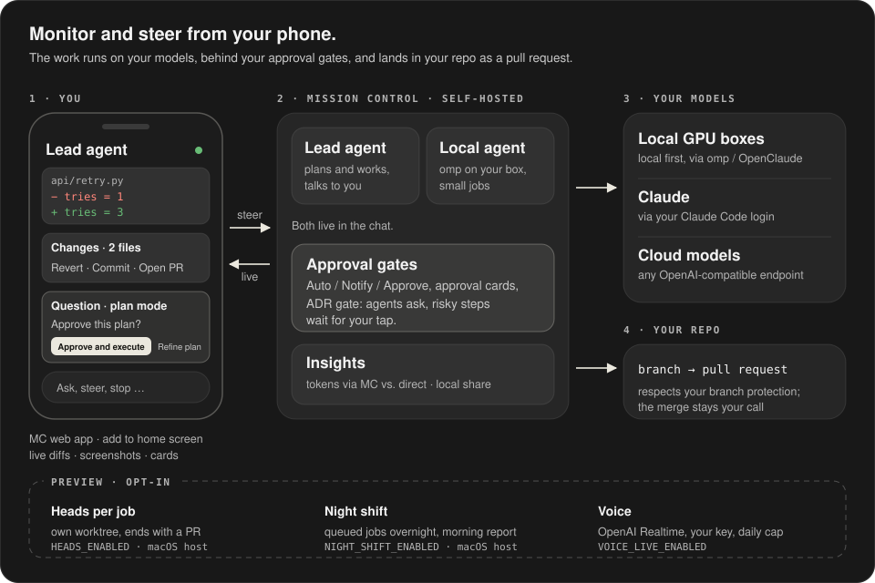

- **Backend:** Python 3.12, FastAPI, SQLModel, PostgreSQL 16, Redis 7,
  Qdrant, Alembic, server-sent events.
- **Frontend:** Next.js 15 (App Router), TypeScript strict, Tailwind CSS v4,
  TanStack Query.
- **Infrastructure:** Docker Compose, Caddy. The backend reaches Docker only
  through a filtering socket proxy.

Full map and "where do I change what": [docs/ARCHITECTURE.md](docs/ARCHITECTURE.md).

## Docs

| You want to… | Read |
|---|---|
| Find your way around `docs/` | [docs/README.md](docs/README.md) |
| Get from install to a remote-controlled agent | [Quickstart](docs/handbook/howto/quickstart.md) |
| Understand the lead agent, heads and the chat as remote control | [Heads and remote control](docs/handbook/concepts/heads-and-remote-control.md) |
| Look things up | [Handbook](docs/handbook/index.md) · [FAQ](docs/handbook/faq.md) |
| Connect GitHub | [docs/setup/github.md](docs/setup/github.md) |
| Update or back up | [Updating](docs/setup/updating.md) · [Backup & restore](docs/handbook/operations/backup-restore.md) |
| Know why things are built this way | [PRINCIPLES](docs/PRINCIPLES.md) · [90 decision records](docs/decisions/) |

## Where it's going

No dates are promised; stages move when their acceptance check passes.
Next in the chat: session list, resume and fork (P4), sending images,
installing plugins, skills and MCP servers through an approval card. The
lead agent's own merge and deploy gate is planned and not built yet. Full
status: [docs/ROADMAP.md](docs/ROADMAP.md).

## Built in the open

- **90 decision records** in [`docs/decisions/`](docs/decisions/), each with
  its reason. Some are still *Proposed*; the status line says which.
- **10,000+ backend and 3,000+ frontend tests**, and a CI pipeline that
  boots a fresh install end to end.
- **Secure defaults:** ports bind to localhost until you opt in (the
  opt-in `voice` profile's LiveKit media ports are the exception),
  Docker only through a filtering socket proxy, secrets encrypted with
  Fernet. Reporting a vulnerability: [SECURITY.md](SECURITY.md).

Development:

```bash
cd backend && python3.12 -m venv .venv && source .venv/bin/activate
pip install -e ".[test]" && pytest -q                  # backend
cd frontend-v2 && npm install && npm run test:run      # frontend
```

`make help` lists the common entry points. Rules for contributors and coding
agents: [CONTRIBUTING.md](CONTRIBUTING.md) · [AGENTS.md](AGENTS.md).

**Language note:** the project grew in a German-speaking home lab. Many ADRs
and some code comments are German; the UI, README and setup are English
(the UI also ships in German).

## Community

- **Questions & ideas** — [GitHub Discussions](https://github.com/argyelan-ai/mission-control/discussions)
- **Bugs** — [GitHub Issues](https://github.com/argyelan-ai/mission-control/issues)
- **Contributing** — [CONTRIBUTING.md](CONTRIBUTING.md)
- **Security** — [SECURITY.md](SECURITY.md)

## License

AGPL-3.0 — see [LICENSE](LICENSE). Use it, self-host it, change it. If you
distribute a modified version or offer it as a network service, share your
changes under the same license. For commercial licensing beyond AGPL,
contact the maintainer.
